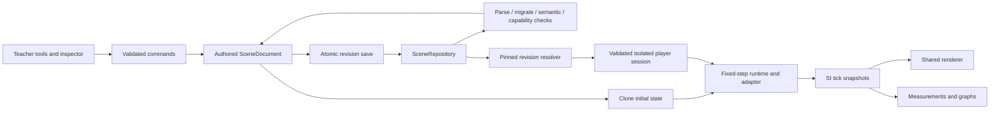

# Architecture

Current MVP access policy: the sandbox is public and identical for all users,
including iframe use. Historical teacher/student access gates below are inactive.
Experimental numerical status is a disclosure, not a user permission.

Status: M0 design updated by M0.5 validation. Isolated PoC code exists; no production runtime/editor modules exist yet. Requirements are in SPEC.md; engine findings in ENGINE_FEASIBILITY.md. Save/reload/embed belongs in the first end-to-end slice, ahead of full M5 integration.

## Module boundaries

Proposed monorepo-style source layout (one Vite application initially; packages need not be separately published):

| Module | Responsibility | Forbidden dependency |
| --- | --- | --- |
| `domain` | Scene types, geometry, units, command invariants, semantic validation, capability requirements | React, browser APIs, engine objects |
| `schema` | JSON Schema, typed parsing, migrations and fixtures | Engine construction or network execution |
| `physics` | Adapter contract, fixed-step runtime, force laws, snapshots and capability registry | Editor state, storage, screen pixels |
| `physics/adapters` | Exact-version engine construction, unit conversion, mass/inertia and contact policy | React, host problem logic |
| `renderer` | SVG scene/view overlays, viewport transforms, hit testing, snapshot interpolation | Saving, engine mutation |
| `editor` | Tools, inspector, commands, undo/redo, selection and draft lifecycle | Raw engine APIs |
| `measurements` | Tick samples, finite differences, energy, bounded series, CSV | Rendering clock |
| `persistence` | SceneRepository, IndexedDB, import/export, immutable revisions | Runtime engine internals |
| `player` | Shared renderer/runtime plus isolated student session and parameter policy | Editor commands, repository write interface |
| `integration` | Revision resolution, embed messages, future authenticated HTTP repository | Physics internals |
| `app` | Composition, routes, errors, storage status and teaching shell | Domain-specific solver shortcuts |

## Data flow

Authored state, runtime state, editor UI state and repository state are distinct. Runtime snapshots never flow back into the authoring document automatically. Save uses authored initial conditions even while preview runs. A future explicit “use current state as initial conditions” command requires a separate design and undo support.

## Scene contract and coordinates

`schemas/scene-v1.schema.json` is the authoritative structural contract; `SCENE_FORMAT.md` adds required semantic rules. Root schemaVersion is the integer 1. The schema covers a draft or saved revision using a discriminated identity object. Runtime contact caches, DOM properties, selection, undo history, timestamps per tick and engine handles are excluded.

Domain axes are x right, y up; angle and angular velocity are counterclockwise. Body position is centre of mass; vertices and force/constraint anchors are local to that frame. Camera uses metres for centre and CSS pixels per metre for scale:

- screenX = width/2 + scale × (x - cameraX)
- screenY = height/2 - scale × (y - cameraY)
- screen angle = -world angle

Inverse transforms apply to pointer events; devicePixelRatio changes backing resolution only. Physics adapter scaling is independent of camera zoom. Geometry is a uniform 2D lamina: disk inertia m r²/2, rectangle m(w²+h²)/12, convex polygon area/inertia from signed-area integrals about its centroid. Polygon vertices must already be centred; reject rather than silently recenter imported anchors.

Mass mode stores kg; density mode stores kg/m². Recompute the derived value on resize, then inertia. Static bodies use solver infinite inertia/mass internally without serializing Infinity.

## Engine adapter and reproducibility

Conceptual interface: `capabilities(profile)`, `validate(scene)`, `create(scene)`, `step(hSeconds, orderedTickInputs)`, `snapshot()`, `dispose()`. Results and diagnostics use SI values. Runtime owns the adapter; UI issues domain commands, never mutates bodies. One engine handles all interacting bodies within a scene.

The persisted simulation profile includes engine name/version, adapter version, compatibility profile, logical timestep, substeps, solver iterations, seed and sleeping setting. These are part of the experiment. Unknown engine versions/profile identifiers fail with an actionable compatibility error. No silent fallback engine or settings changes. Registry profiles fix contact combination rules, engine length scaling, geometric approximation resolution and collision slop; a change creates a new profile. The included example uses a deliberately unqualified profile and must not run until that exact profile is registered and tested.

For Matter, if L native length units represent one metre and native time is milliseconds: position scales by L; acceleration scales by L/10^6; normalized getter/setter velocity scales by L × (1000/60)/1000; force scales by L/10^6 with kg retained; inertia by L²; torque by L²/10^6. Angular velocity accessors scale by (1000/60)/1000, with sign inversion if the adapter uses y down. These conversions are source-derived proposals and must pass independent dimensional tests. Keep native drag zero for no-air experiments and supply SI inertia explicitly. Prefer an adapter using y-up numbers directly where possible; rendering alone flips axes. Never confuse force clearing each update with a persistent force definition.

Candidate default: logical dt 1/120 s, two substeps h = 1/240 s, sleeping disabled. Solver iterations are stored explicitly; candidate 12 position/12 velocity/8 constraint iterations subject to qualification. Each logical tick applies ordered inputs, reapplies external/spring forces at each substep, steps the engine, then emits SI snapshots and measurements. Stable object-ID creation order and seeded random sources prevent incidental variation. There are no random physics forces in v1.

The wall-clock accumulator only schedules logical ticks. At most 8 ticks per render; on excess backlog pause with a visible status and clear wall-time backlog without advancing simulation time. On tab visibility loss pause. Slow motion scales accumulated wall time, not h. Step executes exactly one logical dt including all substeps. Reset disposes and recreates a fresh world from a validated initial copy. Resume is not a serialization of solver internals; saved scenes restart at t=0.

Start on the main thread behind the adapter. If profiling requires a Worker, move the runtime and tick sampling together, send typed immutable snapshots with sequence/tick numbers, and keep inputs tick-stamped. No shared mutable React/engine state.

## Local-first persistence

`SceneRepository` exposes `list`, `create`, `getRevision`, `saveRevision(expectedHead)`, `duplicate` and `export`; the player receives only a separate `RevisionResolver.getRevision`. Save clones and validates before a transaction. IndexedDB stores:

- `simulations`: simulationId, title, headRevisionId, createdAt, updatedAt.
- `revisions`: composite key (simulationId, revisionId), parentRevisionId, revision number and immutable SceneDocument.

Use crypto.randomUUID (secure contexts); collision-check on create. A transaction checks expectedHead, inserts a new revision, and updates the head atomically. Multiple-tab conflicts return a conflict result and keep both edits available; do not last-write-wins. First save uses revisionNumber=1 and no parent. Subsequent saves preserve simulationId, increment sequence and reference the current head. Undo history is in-memory editor state, separate from saved version history. Restore loads an old revision into a draft and saves a new head with explicit provenance in future metadata, never rewrites history.

Import is capped before parsing, validates schema and semantics in isolation, and previews capability errors before committing. Default import as copy assigns a new simulationId/revisionId and remaps body/constraint/force/measurement/control IDs and references. An explicit preserve-identity import must detect existing identical revision vs conflict and refuse conflicting content. Import does not imply installing an engine or trusting schema URLs. Export is an initial-state SceneDocument, not database credentials or an executable program. IndexedDB is not a backup; offer portable downloads.

## Embed and BaanPhys integration

Canonical route: `/player/:simulationId?revision=:revisionId`. Revision is mandatory for problem embeds; editor preview may resolve current head once and then pin it. BaanPhys stores `{simulationId, revisionId, playerContractVersion: 1}` on the problem, not an unpinned head URL. The host renders an iframe at a configured trusted player origin. Local IDs work only where the relevant IndexedDB exists; cross-device embedding needs a published revision or explicit portable payload handoff.

M5 adds an HTTP repository/resolver without changing SceneDocument or the runtime. Proposed endpoints: authenticated POST `/api/simulations`, authenticated POST `/api/simulations/:id/revisions` with expected-head concurrency token, and authorized GET `/api/simulations/:id/revisions/:revisionId`. Server assigns/checks ownership, validates again and stores immutable revisions; publishing is an explicit operation, not a side effect of local Save. Local-only saves keep their global IDs on publication; collision/conflict handling cannot overwrite another owner's record. Publication failure retains local data. No anonymous write endpoint. Public revisions are readable intentionally; private ones use authenticated resolution or short-lived access grants outside the scene.

Embed contract v1: `ready`, `loadScene` (portable prototype only), `loaded`, `error`, `resize` and optionally `playbackState`. Envelope includes protocolVersion=1, type and requestId; payload shape and length are validated. Bind to a configured exact origin and the iframe's `event.source`; use exact targetOrigin, never '*'. Ignore unknown messages, arbitrary URLs and write requests. The player can request height but the host bounds it. No submission/grading or arbitrary commands in v1.

Prefer a separate player origin with a sandbox allowing scripts and, only when required, same-origin storage/fullscreen permissions. A same-origin development harness is not the production isolation boundary. Specify host `frame-src`, player `frame-ancestors` allowlist and CORS/access policy during M5. An iframe alone is not authorization.

Student controls refer to typed body initial mass, velocity components or gravity components with finite ranges. All fields are locked by default. Apply validated permitted overrides to a session copy before reset; neither URL parameters nor postMessage can change locked fields, engine settings or persistence. Clamp only UI sliders within teacher-defined ranges; reject out-of-range external input. Client locks protect authorship UX, not secret information or anti-cheating. Future assessments require server-side validation.

## Risks and decision ownership

| Risk/open decision | Mitigation and decision gate |
| --- | --- |
| Engine passes collision demos but fails rotation/mechanisms | Headless qualification before M1; capability-specific gates before M3/M7. |
| ≤1% accuracy depends on horizon/scale | Explicit fixtures, convergence runs and published supported envelope; no universal accuracy badge. |
| Local embed mistaken for durable share | Local-only label, tested harness, publication required at M5. |
| Existing BaanPhys APIs/origins unknown | Agree problem reference/auth/access contract before M5; do not invent an existing API. |
| Large mass ratio, thin contacts, stiff spring instability | Stress tests and actionable validation diagnostics, never hidden physics alterations. |
| iPad SVG/performance/input uncertainty | Named-device profiling and pointer tests before renderer/Worker changes. |
| Future schema/engine migration changes answers | Preserve original revision/profile; explicit migrations and replay reports. |
| Contact forces unavailable | Label impulse/averages correctly; defer reaction-force meters until validated. |

## M0.5 engine selection and M1 boundary update

Planck.js 1.5.1 is selected for the future production adapter (DECISIONS.md ADR-001); measured evidence and failed cases are in BENCHMARKS.md. Keep the adapter replaceable, but ship one interacting-world solver. The comparison at `poc/engine-comparison` is excluded from production imports/bundles and remains a qualification tool, not an application package.

The initial production profile is planned as `planck-1.5.1-si-v1`, with timestepSeconds=1/120, substeps=4 (h=1/480), position/velocity=12/12. The required Scene `constraint` budget must equal 12 in this profile and maps to the shared joint solver; there is no separate third Planck iteration control. Reject incompatible settings instead of ignoring them. Set global restitution velocityThreshold=0 once before worlds; retain and document native skin/slop/translation/rotation limits. Predict/detect out-of-envelope motion rather than allow invisible engine clamps. No production profile is registered by this documentation alone.

Initial supported materials require staticFriction=friction because Planck exposes one Coulomb coefficient. Reject unequal values for execution and preserve them for inspection/export; never silently change source data. This is a capability restriction on Scene v1, not a schema rewrite. Existing unqualified Matter examples stay unchanged and do not acquire a fallback engine. BaanPhys restricts this profile to convex 3–8 vertices initially (C source inspection confirms the pinned native Planck limit is 12), and blocks larger schema-valid polygons until compound decomposition is qualified.

PoC feasibility for revolute/distance/rope and custom Hooke forces is positive, but M3 features still require production acceptance tests. Rolling is not accuracy-certified: maximum slip and contact penetration failed. Actual Safari/iPad, UI/render performance, persisted replay and cross-browser reproducibility are untested M1/release gates. No finding changes immutable authored revisions, pinned local player isolation or M5 server-publication requirements.
